## GNOME Shell extensions
- [Keyboard Informer](https://github.com/tomasmark79/kbd-informer) — show modifier and lock-key states in GNOME Shell [5759 Downloads](https://extensions.gnome.org/extension/8500/keyboard-informer/)
- [Blur Wallpaper](https://github.com/tomasmark79/blur-wallpaper) — create a smooth, adjustable blurred wallpaper [1052 Downloads](https://extensions.gnome.org/extension/9556/blur-wallpaper-with-adjustable-intensity/)
- [My Vision](https://github.com/tomasmark79/my-vision) — save and quickly switch between display profiles [379 Downloads](https://extensions.gnome.org/extension/9014/my-vision/)
- [Window Shuffle](https://github.com/tomasmark79/window-shuffle) — distribute windows across workspaces and collect them back [122 Downloads](https://extensions.gnome.org/extension/10853/window-shuffle/)
- [TranslatePlace](https://github.com/tomasmark79/TranslatePlace) — translate selected drafts in whole GNOME Shell [4 Downloads](https://extensions.gnome.org/extension/11231/translateplace/)

## NixOS Tools

**One recipe. Multiple machines. Reproducible NixOS servers.**

 - [NixBerry](https://github.com/tomasmark79/nixberry) lets you build and manage servers from declarative configuration. Keep the system in a shared recipe, then define each machine's configuration, platform, network and resources — making it easier to recreate a server or add another machine. **Platforms:** QEMU/KVM (libvirt) · Hyper-V · Proxmox VE · VirtualBox · VMware Workstation · Raspberry Pi 5.  
 [NixBerry Matrix Channel](https://matrix.to/#/#nixberry:matrix.org)

**A starting point for command-line applications.**

 - [NixonCpp](https://github.com/tomasmark79/NixonCpp) — Create your C++ applications and libraries. [A running WebAssembly build that documents the project it represents.](https://tomasmark79.github.io/NixonCpp)

<!-- readme-pdf:exclude:start -->

<picture>
  <source media="(prefers-color-scheme: dark)" srcset="assets/factory/workshop-dark.svg" />
  <source media="(prefers-color-scheme: light)" srcset="assets/factory/workshop-light.svg" />
  
</picture>

<!-- readme-pdf:exclude:end -->

## Translation Bundle

Translate selected text with your own AI translation server. Start with the server, then choose the extension for your desktop, browser or email client:

- [Translation API](https://github.com/tomasmark79/translation-api) — the shared server, using Ollama and `translategemma:4b` by default. Its README covers installing Ollama, downloading the model and starting the API on your computer.
- [TranslatePlace](https://github.com/tomasmark79/TranslatePlace) — a GNOME Shell extension with two target languages, configurable shortcuts, local history and optional automatic replacement of selected text.
- [WebTranslatePlace](https://github.com/tomasmark79/WebTranslatePlace) — translate selected drafts in Chrome/Chromium and Firefox, or selected email text in Thunderbird. Replace selections while composing; view translations separately while reading email. Includes draft history, two target languages and additional Discord message translation.

Both extensions connect to Translation API at `http://127.0.0.1:5001` by default. Follow the chosen extension's README for installation. WebTranslatePlace also has Safari and GNOME Web targets; Safari requires live verification, and GNOME Web is experimental with known failures.

## Filesystem tools
- [Modern Midnight Commander](https://github.com/tomasmark79/mc) — a fork with trash actions, Wayland clipboard support, DotName skins, and ultra-fast ZIP extraction, packaged with Nix.

## Backup tools
- [SafeData](https://github.com/tomasmark79/safedata) — Universal backup script for LVM volumes and regular directories. It supports rsync and tar backups with include, exclude, or all filtering rules while preserving extended filesystem metadata.

## Music production hardware & software
- [DreamScaler](https://tomasmark79.github.io/DreamScalerWeb) — DreamScaler brings musical scales, harmony, and color to your keys with a standalone app and an LED strip.
- [Bitwig Cheatsheet](https://github.com/tomasmark79/bitwig-cheatsheet) — find Bitwig Studio keyboard shortcuts for Windows, Linux, and macOS mapped to a standard ISO/QWERTY keyboard layout.
- [Bitwig Transport Control Script](https://github.com/tomasmark79/bitwig-transport-control-script) — control Bitwig Studio transport with mouse side buttons, even when a plugin window has focus, on Linux with X11.
